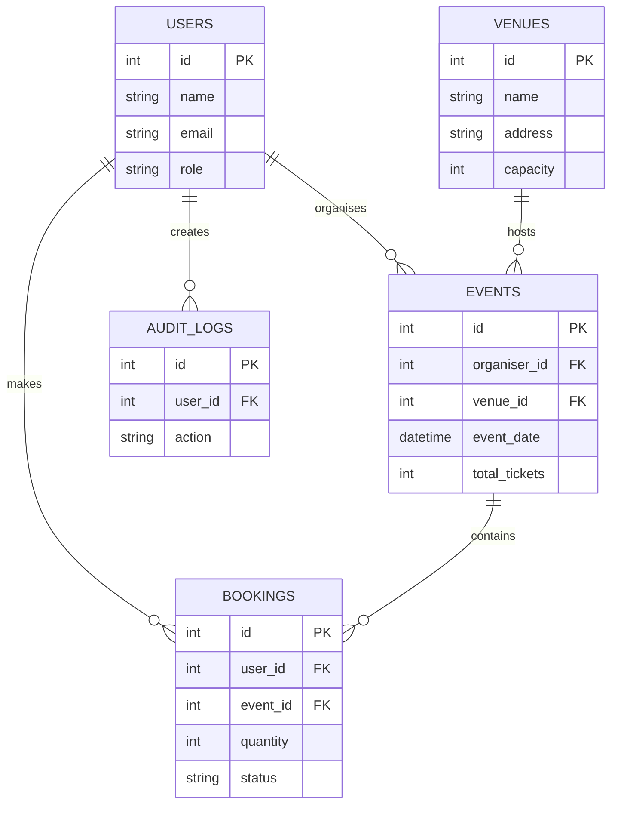

# Architecture and ERD

Browser (`frontend/index.html`) → JavaScript modules (`frontend/js`) → PHP entrypoint (`backend/index.php`) → individual resource controllers → helper services / PDO → MySQL.

Ticket sales are calculated using confirmed bookings. Venue capacity bounds tickets. Foreign keys restrict deleting resources with existing dependencies.
